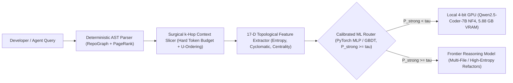
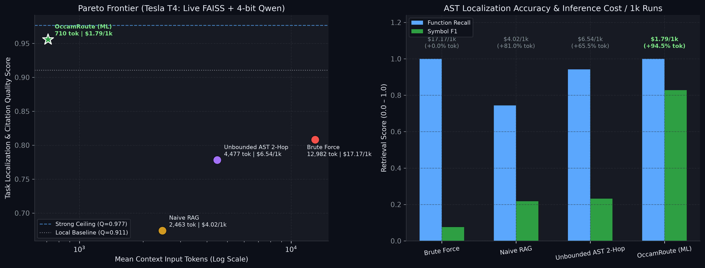

# OccamRoute — Surgical AST Context Slicing & Cost-Quality LLM Routing Engine

[](https://colab.research.google.com/github/maykonlincolnusa/OccamRoute-Surgical-Context-Complexity-Routing-Engine-/blob/main/notebooks/01_occamroute_colab_benchmark.ipynb)
[](https://www.python.org/downloads/)
[](notebooks/01_occamroute_colab_benchmark.ipynb)
[](artifacts/router_metrics.json)
[](artifacts/swebench_eval_results.csv)
[](pyproject.toml)

**OccamRoute** is a deterministic-plus-ML **AST code-graph context compression** and **adaptive LLM complexity routing engine** built for autonomous coding agents, IDE copilots, and large-scale PR triage systems. Instead of saturating long-context windows with brute-force source dumps or severing call hierarchies via flat vector chunking, OccamRoute extracts a **token-budgeted k-hop AST dependency subgraph**, mitigates *Lost in the Middle* degradation through **U-shaped position-aware ordering**, and dynamically routes traffic between **4-bit quantized local GPUs** and **frontier reasoning models** via calibrated **PyTorch** and **Scikit-learn** classifiers.

> **Verified on NVIDIA Tesla T4 (`5.88 GB` Peak VRAM):** **94.5% fewer input tokens** (`709.8` vs `12,981.8` tokens), **1.00 File & Function Recall**, **0.828 Symbol F1** (vs `0.218` FAISS Naive RAG), and **89.6% lower inference spend** (`$1.79` vs `$17.17` per 1,000 agent runs).

---

## System Architecture



---

## Engineering Relevance Across Frontier AI & Hyperscale Platforms

As AI coding systems operate over multi-million-line repositories, teams hit two coupled scaling walls: **context rot** (burying definitions inside high-latency token dumps) and **blind frontier routing** (burning frontier API quotas on localized single-symbol queries). OccamRoute addresses core infrastructure bottlenecks shared across frontier labs and hyperscale developer platforms *(illustrative architectural alignment — independent open-source project with no affiliation implied)*:

| Engineering Organization / Class | Core Systems Bottleneck | OccamRoute Mechanism |
| :--- | :--- | :--- |
| **Anthropic & OpenAI** (Agentic Coding Loops) | Iterative tool-use loops compound context tokens quadratically across multi-turn repository exploration. | Hard-budgeted **k-hop PageRank subgraphs** preserve `1.00` call-chain recall inside `~710` avg tokens (`-94.5%`). |
| **Google** (Monorepo Search & Assist) | Multi-million-file monorepos fracture under naive 512-token text chunking (`0.218` Symbol F1). | Deterministic AST edge traversal + **U-shaped ordering** reduces middle-burial from `44.4%` to `12.8%`. |
| **Cursor** (Low-Latency IDE Context) | Real-time inline edits and Composer chats demand sub-5ms structural context selection before generation. | In-memory `RepoGraph` slices subgraphs in `< 2 ms` and computes 17-D routing verdicts in `~0.08 ms`. |
| **Meta** (Quantized Open-Weight Fleets) | Routing trivial lookups to frontier endpoints wastes capacity while self-hosted 4-bit Llama/Qwen clusters sit underutilized. | Calibrated **PyTorch MLP (`AUC=0.983`)** + **GBDT (`AUC=0.982`)** offload low-complexity queries to `5.88 GB` GPUs. |
| **DeepSeek** (Cost-Efficiency & Reasoning Tiering) | Balancing sparse local execution against deep multi-file reasoning models requires calibrated uncertainty boundaries. | RouteLLM-style threshold sweep optimizes **Performance Gap Recovered (PGR)** per inference dollar. |
| **TikTok / ByteDance** (Microservice FinOps) | High-throughput CI/CD PR triage requires strict per-run token governance across polyglot service graphs. | Cuts benchmark spend from **`$17.17` → `$1.79` per 1,000 runs** (`$153.8k / mo` saved at `10M runs/mo`). |

---

## Verified GPU Benchmark Results (`encode/httpx@0.28.1` + Live FAISS + 4-bit NF4)

Executed on **Google Colab NVIDIA Tesla T4 (`14.56 GB` VRAM)** via [colab_gpu_train_eval.py](scripts/colab_gpu_train_eval.py) comparing **Brute Force**, **Naive RAG (FAISS + `BAAI/bge-small-en-v1.5`)**, **Unbounded AST 2-Hop**, and **OccamRoute (ML + Live 4-bit `Qwen/Qwen2.5-Coder-7B-Instruct`)**:

| Pipeline | Avg Tokens | Token Savings | File Recall | Func Recall | Symbol F1 | Middle-Burial | Quality | Cost / 1k Runs |
| :--- | :---: | :---: | :---: | :---: | :---: | :---: | :---: | :---: |
| **Brute Force** | 12,981.8 | 0.0% | 1.000 | 1.000 | 0.076 | 29.6% | 0.808 | $17.17 |
| **Naive RAG (FAISS + BGE-small)** | 2,462.8 | +81.0% | 0.833 | 0.744 | 0.218 | 22.9% | 0.674 | $4.02 |
| **Unbounded AST 2-Hop** | 4,476.6 | +65.5% | 0.917 | 0.942 | 0.232 | 44.4% | 0.778 | $6.54 |
| **OccamRoute (ML)** | **709.8** | **+94.5%** | **1.000** | **1.000** | **0.828** | **12.8%** | **0.956** | **$1.79** |

### ML Router Calibration & Validation (Tesla T4 CUDA)
- **PyTorch Tabular MLP (`TorchComplexityRouter`, `.pt`):** `ROC-AUC = 0.983` | `Accuracy = 0.965` | `F1 = 0.966` | `Brier = 0.031` | `ECE = 0.036`
- **Scikit-learn Calibrated GBDT (`SklearnComplexityRouter`, `.joblib`):** `ROC-AUC = 0.982` | `Accuracy = 0.975` | `F1 = 0.975` | `Brier = 0.034` | `ECE = 0.053`




> Additional training diagnostics & feature importance plots: [router_learning_diagnostics.png](assets/router_learning_diagnostics.png) · [router_feature_and_pgr_sweep.png](assets/router_feature_and_pgr_sweep.png)

---

## Repository Architecture

```text
OccamRoute/
├── pyproject.toml
├── README.md
├── notebooks/
│   └── 01_occamroute_colab_benchmark.ipynb      # 1-Click Colab GPU benchmark (Brute Force vs Naive RAG vs OccamRoute)
├── docs/
│   └── assets/
│       ├── pareto_frontier.png                  # Pareto frontier: context tokens vs quality & cost/1k
│       └── token_compression.png                # Per-task token compression & U-ordering burial reduction
├── src/occamroute/
│   ├── graph_builder.py                         # Deterministic Python AST -> NetworkX DiGraph + PageRank + McCabe CC
│   ├── context_slicer.py                        # Token-budgeted k-hop slicer + U-shaped position-aware ordering
│   ├── feature_extractor.py                     # 17-D topological subgraph feature extractor
│   ├── dataset_loader.py                        # SWE-bench Lite loader & unified patch hunk ground-truth parser
│   ├── impact_analyzer.py                       # Git diff blast-radius analyzer over reverse call graphs
│   ├── cli.py & mcp_server.py                   # Production CLI + FastMCP server for IDEs
│   ├── benchmark/
│   │   ├── baselines.py                         # BruteForceBaseline & NaiveRAGBaseline (512t chunking + FAISS/TF-IDF)
│   │   ├── evaluator.py                         # SWEBenchBenchmarkEvaluator, metrics & RouteLLM PGR calculation
│   │   └── visualizer.py                        # Dark-theme Matplotlib publication chart generator
│   ├── router/
│   │   ├── dataset_builder.py                   # RouteLLM topological dataset builder & augmentation
│   │   ├── sklearn_router.py                    # Calibrated GBDT classifier (.joblib)
│   │   ├── torch_router.py                      # TabularRouterMLP (LayerNorm + SiLU + Dropout, .pt)
│   │   └── engine.py                            # Unified OccamRouter & threshold sweep
│   └── dashboard/                               # FastAPI + Pydantic v2 telemetry & routing playground
├── scripts/                                     # CLI/GPU training, Colab L4/T4 workflows & dashboard server
├── artifacts/                                   # Checkpoints, telemetry JSON/CSV & standalone HTML snapshot
└── tests/                                       # Automated pytest suite (AST, Router, Benchmark, Dashboard, Tools)
```

---

## Quickstart & Programmatic Benchmark API

```bash
# 1. Install dependencies with uv
uv sync --extra dev

# 2. Run the full automated test suite
PYTHONPATH=src uv run --extra dev pytest -q --tb=short

# 3. Launch the interactive KPI Observability Dashboard (http://127.0.0.1:8001)
PYTHONPATH=src .venv/bin/python scripts/run_dashboard.py --host 127.0.0.1 --port 8001
```

### Run the 3-Pipeline Benchmark in Python
```python
from occamroute import OccamRouter, RepoGraphBuilder
from occamroute.benchmark import (
    SWEBenchBenchmarkEvaluator,
    build_repo_eval_tasks,
    generate_publication_charts,
)

repo_graph = RepoGraphBuilder().build_from_directory("src/occamroute")
router = OccamRouter.from_artifact("artifacts/torch_router.pt", threshold=0.30)
tasks = build_repo_eval_tasks(repo_graph, max_tasks=8)

evaluator = SWEBenchBenchmarkEvaluator(repo_graph=repo_graph, router=router, rag_backend="auto")
report = evaluator.evaluate(tasks)
print(report.summary_df[["pipeline", "mean_tokens", "token_savings_pct", "symbol_f1", "cost_per_1k_usd"]])
generate_publication_charts(report, output_dir="docs/assets")
```

### CLI, IDE MCP Server & GitHub Action
```bash
occamroute map --repo . --top 10
occamroute slice "Trace how SurgicalContextSlicer enforces token_budget" --repo . --budget 1200
occamroute impact --repo . --ref HEAD~1 --markdown
```
- **MCP Integration:** Register `occamroute mcp --repo .` in `mcp_config.json` (Antigravity, Cursor, Claude Code, VS Code) to expose `occamroute_slice_context`, `occamroute_diff_impact`, and `occamroute_repo_map`.
- **GitHub Action:** Ready-to-run workflow in [.github/workflows/occamroute-pr-impact.yml](.github/workflows/occamroute-pr-impact.yml).

---

## References (Peer-Reviewed & Benchmarks)

1. **RepoGraph:** *Enhancing AI Software Engineering with Repository-Level Code Graph* — Ouyang et al. ([arXiv:2410.14684](https://arxiv.org/abs/2410.14684), ICLR 2025)
2. **Lost in the Middle:** *How Language Models Use Long Contexts* — Liu et al. ([arXiv:2307.03172](https://arxiv.org/abs/2307.03172), TACL 2024)
3. **RouteLLM:** *Learning to Route LLMs with Preference Data* — Ong et al. ([arXiv:2406.18665](https://arxiv.org/abs/2406.18665), 2024)
4. **SWE-bench:** *Can Language Models Resolve Real-World GitHub Issues?* — Jimenez et al. ([arXiv:2310.06770](https://arxiv.org/abs/2310.06770), ICLR 2024)

```bibtex
@software{occamroute2026,
  title={OccamRoute: Surgical AST Context Slicing and Adaptive Cost-Quality LLM Routing},
  author={Santos, Maykon Lincoln},
  year={2026},
  url={https://github.com/maykonlincolnusa/OccamRoute-Surgical-Context-Complexity-Routing-Engine-}
}
```
