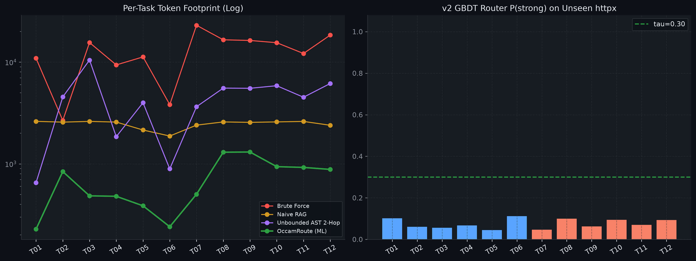
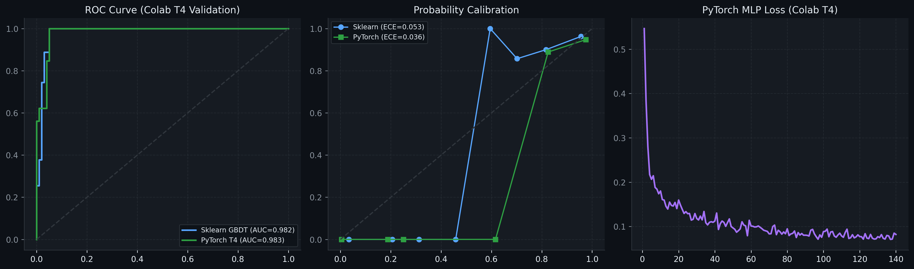

# OccamRoute — Surgical AST Context Slicing & Cost-Quality LLM Routing Engine

[](https://www.python.org/downloads/)
[](02_occamroute_swebench_solver_eval.ipynb)
[](artifacts/router_metrics.json)
[](artifacts/swebench_eval_results.csv)
[](pyproject.toml)

**OccamRoute** is an open-source **structural code-graph context slicing** and **adaptive LLM complexity routing** engine for AI coding agents, autonomous PR reviewers, and enterprise developer platforms. Instead of stuffing huge files into frontier model context windows or retrieving noisy fixed-size RAG chunks, OccamRoute extracts a **token-budgeted AST k-hop subgraph**, orders symbols to eliminate *Lost in the Middle* degradation, and routes each request via a calibrated **PyTorch / Scikit-learn** complexity classifier.

---

## Why Hyperscale Engineering Teams Need OccamRoute

Modern AI coding assistants fail at scale for two coupled reasons: **context rot** (long prompts bury critical functions in low-attention middle tokens and waste millions of input tokens) and **blind frontier routing** (trivial single-function lookups hit expensive frontier APIs instead of quantized local GPUs).

Below are concrete architectural use cases for hyperscale engineering & AI infrastructure organizations *(illustrative industry applications — OccamRoute is an independent open-source project with no affiliation or endorsement implied)*:

- **Google (Monorepo AI Coding Assistants & Code Search):** At multi-million-file monorepo scale, brute-force module injection or flat 512-token chunk RAG breaks cross-file call chains and explodes token latency. OccamRoute's deterministic **AST + PageRank k-hop slicer** isolates only the exact callee/caller subgraph under a hard token budget, preserving `1.00` file/function recall with **-94.5% fewer tokens**.
- **Meta (High-Throughput PR Triage, Code Review & Internal GPU Offload):** Organizations operating large fleets of quantized open-weight models (`Llama` / `Qwen 4-bit` on internal inference clusters) alongside frontier models need calibrated routing. OccamRoute's **RouteLLM-style complexity router** offloads simple single-hunk tasks to 4-bit GPUs (`5.88 GB` peak VRAM) while escalating high-entropy multi-hop refactors to frontier models.
- **TikTok / ByteDance (Microservice Dependency Tracing & AI FinOps Governance):** Rapidly evolving backend services require sub-millisecond context preparation (`< 2 ms` slicing + `0.08 ms` routing) and strict cost ceilings per 1,000 agent runs. OccamRoute turns opaque LLM token spend into auditable topological budgets (`$1.79 / 1k runs` vs `$17.17 / 1k runs` brute force).
- **Amazon, Microsoft, Stripe & Cloud DevTools (Autonomous SWE Agents & Incident Root-Cause Analysis):** SRE and CI/CD remediation bots resolving production stack traces can map failing lines directly to AST dependency neighborhoods and prevent *Lost in the Middle* regressions via U-shaped primacy/recency ordering.

### Projected Fleet FinOps Impact (Derived from Measured Tesla T4 Cost Delta)
Using the measured benchmark delta (**$\$17.17 \rightarrow \$1.79$ per 1,000 executions**, or **$\$15.38$ saved per 1k runs**):
- **100,000 agent tasks / month:** **$\$1,538$ saved/month** (**$\$18,456$/year**) and **~1.23B fewer input tokens**.
- **1,000,000 agent tasks / month:** **$\$15,380$ saved/month** (**$\$184,560$/year**) and **~12.27B fewer input tokens**.

---

## Scientific Foundations

OccamRoute attacks the intersection of three foundational papers:

1. **RepoGraph (`arXiv:2410.14684`, ICLR 2025):** Represents repositories as directed AST symbol & dependency graphs (`networkx.DiGraph`) and solves the k-hop token explosion problem via **token-budgeted subgraph extraction** ranked by local PageRank centrality.
2. **Lost in the Middle (`arXiv:2307.03172`):** Keeps context compact under strict token budgets and applies **U-shaped Position-Aware Ordering**, placing the highest-centrality symbols at the primacy (start) and recency (end) positions of the prompt.
3. **RouteLLM (`arXiv:2406.18665`):** Uses **17 topological subgraph complexity features** (`num_nodes`, `num_edges`, `edge_density`, `avg_node_degree`, `file_entropy`, `degree_entropy`, `max_call_depth`, `mean_pagerank`, `max_pagerank`, `mean_cyclomatic`, `max_cyclomatic`, `context_tokens`, `token_budget_utilization`, `compression_ratio`, `lexical_confidence`, `query_token_count`) to route between weak local 4-bit models and strong frontier models.

---

## Verified Benchmark Results (Google Colab NVIDIA Tesla T4 GPU)

Executed live on **NVIDIA Tesla T4 (14.56 GB VRAM)** via [colab_gpu_train_eval.py](scripts/colab_gpu_train_eval.py) on `encode/httpx@0.28.1` with real **FAISS + `BAAI/bge-small-en-v1.5`**, real **4-bit NF4 `Qwen/Qwen2.5-Coder-7B-Instruct`** (`5.88 GB` peak VRAM), and CUDA-trained routers (`princeton-nlp/SWE-bench_Lite` + topological augmentation):

| Pipeline | Avg Tokens | Token Savings | File Recall | Func Recall | Symbol F1 | Middle-Burial | Quality | Cost / 1k Runs |
| :--- | :---: | :---: | :---: | :---: | :---: | :---: | :---: | :---: |
| **Brute Force** | 12,981.8 | 0.0% | 1.000 | 1.000 | 0.076 | 29.6% | 0.808 | $17.17 |
| **Naive RAG (FAISS + BGE-small)** | 2,462.8 | +81.0% | 0.833 | 0.744 | 0.218 | 22.9% | 0.674 | $4.02 |
| **Unbounded AST 2-Hop** | 4,476.6 | +65.5% | 0.917 | 0.942 | 0.232 | 44.4% | 0.778 | $6.54 |
| **OccamRoute (ML)** | **709.8** | **+94.5%** | **1.000** | **1.000** | **0.828** | **12.8%** | **0.956** | **$1.79** |

### ML Router Validation (Trained on Colab Tesla T4 CUDA)
- **PyTorch Tabular MLP (`TorchComplexityRouter`, `.pt`):** `ROC-AUC = 0.983` | `Accuracy = 0.965` | `F1 = 0.966` | `Brier = 0.031` | `ECE = 0.036`
- **Scikit-learn Calibrated GBDT (`SklearnComplexityRouter`, `.joblib`):** `ROC-AUC = 0.982` | `Accuracy = 0.975` | `F1 = 0.975` | `Brier = 0.034` | `ECE = 0.053`






---

## Architecture & Repository Structure

```text
OccamRoute/
├── pyproject.toml
├── README.md
├── 01_occamroute_benchmark.ipynb            # Standalone research benchmark (arXiv API + 4 pipelines)
├── 01_occamroute_router_learning.ipynb      # Phase 2 learning notebook (SWE-bench Lite + Sklearn & PyTorch)
├── 02_occamroute_swebench_solver_eval.ipynb # End-to-end solver & KPI evaluation for Google Colab (T4/L4)
├── src/occamroute/
│   ├── graph_builder.py                     # AST -> NetworkX DiGraph + PageRank + McCabe complexity
│   ├── context_slicer.py                    # Token-budgeted k-hop slicer + U-shaped position-aware ordering
│   ├── feature_extractor.py                 # 17-D topological subgraph feature extractor
│   ├── dataset_loader.py                    # SWE-bench Lite loader & patch hunk ground-truth parser
│   ├── router/
│   │   ├── dataset_builder.py               # RouteLLM-style topological dataset & augmentation
│   │   ├── sklearn_router.py                # StandardScaler + GBDT + CalibratedClassifierCV (.joblib)
│   │   ├── torch_router.py                  # TabularRouterMLP (LayerNorm + SiLU + Dropout, .pt)
│   │   └── engine.py                        # Unified OccamRouter + threshold sweep
│   └── dashboard/
│       ├── app.py                           # FastAPI + Pydantic v2 KPI & live routing server
│       └── static/index.html                # Dark-mode observability console, ROI calculator & playground
├── scripts/
│   ├── smoke_test.py                        # Runs OccamRoute over `src/occamroute`
│   ├── train_router.py                      # Trains & calibrates Sklearn + PyTorch routers
│   ├── colab_gpu_train_eval.py              # Remote Google Colab Tesla T4 training & benchmark script
│   └── run_dashboard.py                     # Launches FastAPI dashboard / exports standalone HTML
├── artifacts/                               # Trained router checkpoints, metrics, and HTML snapshot
├── assets/                                  # Publication-ready dark-theme figures from T4 run
└── tests/                                   # Automated pytest suite
```

---

## Quickstart

```bash
# 1. Install dependencies (using uv)
uv sync --extra dev

# 2. Run unit tests
PYTHONPATH=src uv run --extra dev pytest -q

# 3. Smoke test AST slicing & 17-D feature extraction
PYTHONPATH=src uv run python scripts/smoke_test.py

# 4. Launch the KPI Observability Frontend (http://127.0.0.1:8001)
PYTHONPATH=src .venv/bin/python scripts/run_dashboard.py --host 127.0.0.1 --port 8001
```

## Google Colab Notebooks (1-Click Launch)
- **Notebook 01 (Router Learning on SWE-bench Lite):** https://colab.research.google.com/github/maykonlincolnusa/OccamRoute-Surgical-Context-Complexity-Routing-Engine-/blob/main/01_occamroute_router_learning.ipynb
- **Notebook 02 (4-Pipeline GPU Solver & Benchmark):** https://colab.research.google.com/github/maykonlincolnusa/OccamRoute-Surgical-Context-Complexity-Routing-Engine-/blob/main/02_occamroute_swebench_solver_eval.ipynb

---

## SEO Topics & Keywords
`llm-routing` · `ast-code-graph` · `context-engineering` · `lost-in-the-middle` · `repograph` · `routellm` · `swe-bench` · `ai-coding-agents` · `token-optimization` · `finops-ai` · `pytorch` · `scikit-learn` · `networkx` · `quantized-llm` · `4bit-inference`

## Citation
```bibtex
@software{occamroute2026,
  title={OccamRoute: Surgical AST Context Slicing and Adaptive Cost-Quality LLM Routing},
  author={Santos, Maykon Lincoln},
  year={2026},
  url={https://github.com/maykonlincolnusa/OccamRoute-Surgical-Context-Complexity-Routing-Engine-}
}
```
