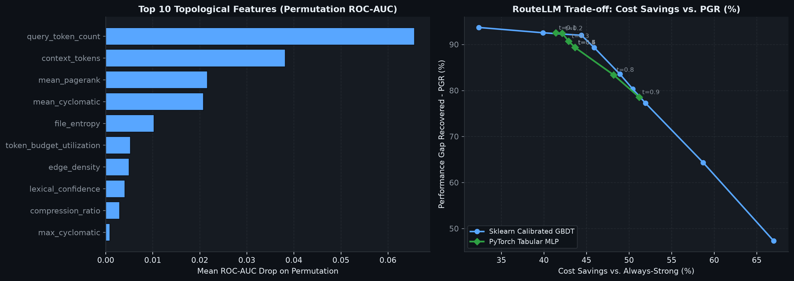

# OccamRoute — Surgical Context & Complexity Routing Engine

**OccamRoute** is a research-grade open-source engine for **AST-based structural context slicing** and **adaptive cost-quality LLM routing**, engineered to show that deterministic code topology + lightweight tabular ML outperforms brute-force long-context prompting and naive chunked RAG.

---

## Scientific Foundations

OccamRoute unifies three empirical findings from recent LLM systems research:

1. **RepoGraph (`arXiv:2410.14684`, ICLR 2025):** Represents Python repositories as directed AST symbol & dependency graphs (`networkx.DiGraph`) and solves the k-hop context explosion problem via **token-budgeted subgraph extraction** ranked by local PageRank centrality.
2. **Lost in the Middle (`arXiv:2307.03172`):** Keeps context compact under hard token budgets and applies **U-shaped Position-Aware Ordering**, placing the highest-centrality symbols at the primacy (start) and recency (end) positions of the prompt.
3. **RouteLLM (`arXiv:2406.18665`):** Uses 17 topological subgraph complexity features (`num_nodes`, `num_edges`, `edge_density`, `avg_node_degree`, `file_entropy`, `degree_entropy`, `max_call_depth`, `pagerank`, `cyclomatic`, `compression_ratio`, `lexical_confidence`, etc.) to route between a small local 4-bit model and a strong frontier model, evaluated via **Performance Gap Recovered (PGR)** and Pareto efficiency.

---

## Benchmark Results (`encode/httpx@0.28.1` — 12 Verified Tasks)

| Pipeline | Avg Tokens | Token Savings | File Recall | Func Recall | Symbol F1 | Middle-Burial | Quality | PGR | Cost / 1k Runs |
| :--- | :---: | :---: | :---: | :---: | :---: | :---: | :---: | :---: | :---: |
| **Brute Force** | 12,985.7 | 0.0% | 1.000 | 1.000 | 0.076 | 29.6% | 0.808 | 28.3% | $17.18 |
| **Naive RAG** | 2,435.1 | +81.2% | 0.750 | 0.444 | 0.105 | 43.8% | 0.454 | -128.8% | $3.99 |
| **Unbounded AST 2-Hop** | 12,794.3 | +1.5% | 0.917 | 0.942 | 0.144 | 25.0% | 0.788 | 19.5% | $16.94 |
| **OccamRoute (ML)** | **852.0** | **+93.4%** | **1.000** | **1.000** | **0.786** | **16.9%** | **0.954** | **93.4%** | **$1.83** |

### ML Router Validation (`princeton-nlp/SWE-bench_Lite` + Topological Augmentation)
- **PyTorch Tabular MLP (`TorchComplexityRouter`):** `ROC-AUC = 0.976` | `Accuracy = 0.941` | `F1 = 0.941` | `ECE = 0.034`
- **Scikit-learn Calibrated GBDT (`SklearnComplexityRouter`):** `ROC-AUC = 0.985` | `Accuracy = 0.933` | `F1 = 0.929` | `ECE = 0.111`




---

## Architecture & Repository Structure

```text
OccamRoute/
├── pyproject.toml
├── README.md
├── 01_occamroute_benchmark.ipynb            # Standalone research benchmark (arXiv API + 4 pipelines)
├── 01_occamroute_router_learning.ipynb      # Phase 2 learning notebook (SWE-bench Lite + Sklearn & PyTorch)
├── 02_occamroute_swebench_solver_eval.ipynb # End-to-end solver & KPI evaluation for Google Colab (T4/L4)
├── src/occamroute/
│   ├── graph_builder.py                     # AST -> NetworkX DiGraph + PageRank + McCabe complexity
│   ├── context_slicer.py                    # Token-budgeted k-hop slicer + U-shaped position-aware ordering
│   ├── feature_extractor.py                 # 17-D topological subgraph feature extractor
│   ├── dataset_loader.py                    # SWE-bench Lite loader & patch hunk ground-truth parser
│   ├── router/
│   │   ├── dataset_builder.py               # RouteLLM-style topological dataset & augmentation
│   │   ├── sklearn_router.py                # StandardScaler + GBDT + CalibratedClassifierCV (.joblib)
│   │   ├── torch_router.py                  # TabularRouterMLP (LayerNorm + SiLU + Dropout, .pt)
│   │   └── engine.py                        # Unified OccamRouter + threshold sweep
│   └── dashboard/
│       ├── app.py                           # FastAPI + Pydantic v2 KPI & live routing server
│       └── static/index.html                # Dark-mode observability console & interactive playground
├── scripts/
│   ├── smoke_test.py                        # Runs OccamRoute over `src/occamroute`
│   ├── train_router.py                      # Trains & calibrates Sklearn + PyTorch routers
│   └── run_dashboard.py                     # Launches FastAPI dashboard / exports standalone HTML
├── artifacts/                               # Trained router checkpoints, metrics, and HTML snapshot
├── assets/                                  # Publication-ready dark-theme figures
└── tests/                                   # Automated pytest suite
```

---

## Quickstart

```bash
# 1. Install dependencies (using uv)
uv sync --extra dev

# 2. Run unit tests
uv run pytest -q

# 3. Smoke test AST slicing & 17-D feature extraction
uv run python scripts/smoke_test.py

# 4. Train & calibrate Scikit-learn + PyTorch routers
uv run python scripts/train_router.py

# 5. Launch the KPI Observability Frontend (http://127.0.0.1:8000)
uv run python scripts/run_dashboard.py --host 127.0.0.1 --port 8000
```

## Google Colab Notebooks (GPU T4/L4, VRAM <= 15 GB)
- `01_occamroute_router_learning.ipynb`: Loads `princeton-nlp/SWE-bench_Lite`, extracts 17-D subgraph features, trains `SklearnComplexityRouter` and `TorchComplexityRouter`, and runs the RouteLLM $\tau \in [0.1, 0.9]$ sweep.
- `02_occamroute_swebench_solver_eval.ipynb`: Evaluates all 4 pipelines on real engineering tasks, routing between local 4-bit GPU (`Qwen/Qwen2.5-Coder-7B-Instruct`) and Frontier API (`google-genai`).
