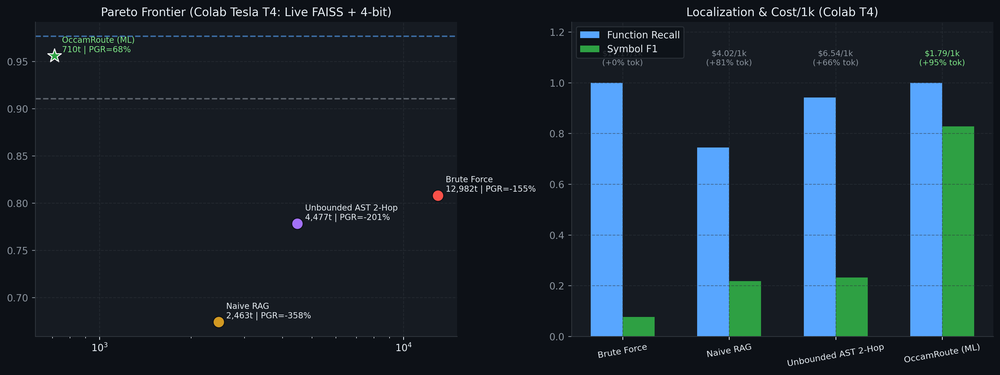

# OccamRoute — Surgical AST Context Slicing & Cost-Quality LLM Routing Engine

[](https://www.python.org/downloads/)
[](02_occamroute_swebench_solver_eval.ipynb)
[](artifacts/router_metrics.json)
[](artifacts/swebench_eval_results.csv)
[](pyproject.toml)

**OccamRoute** is an open-source **AST code-graph context compression** and **adaptive LLM complexity routing engine** for AI coding agents, autonomous PR reviewers, and enterprise developer platforms. Instead of stuffing huge source files into long-context windows or retrieving fragmented chunks via vector RAG, OccamRoute slices a **token-budgeted k-hop AST dependency subgraph**, eliminates *Lost in the Middle* degradation via U-shaped ordering, and routes requests between **4-bit quantized local GPUs** and **frontier LLMs** using calibrated **PyTorch** and **Scikit-learn** classifiers.

> **Core Result (Verified on NVIDIA Tesla T4, 5.88 GB Peak VRAM):** **94.5% token reduction** (`709.8` vs `12,981.8` tokens), **1.00 File & Function Recall**, **0.828 Symbol F1** (vs `0.218` FAISS Naive RAG), and **89.6% lower inference cost** (`$1.79` vs `$17.17` per 1,000 agent runs).

---

## Built for Hyperscale Engineering & AI Infrastructure Teams

As AI coding assistants and autonomous software agents scale across massive repositories, engineering organizations face two coupled bottlenecks: **context rot** (long prompts bury critical definitions in low-attention middle tokens while inflating input token bills) and **blind frontier routing** (trivial symbol lookups hit expensive frontier APIs instead of quantized open-weight GPUs).

OccamRoute addresses concrete architectural challenges encountered by high-scale engineering platforms *(illustrative industry use cases — OccamRoute is an independent open-source project with no affiliation or endorsement implied)*:

- **Google (Monorepo AI Coding Assistants & Code Search):** Across multi-million-file monorepos, brute-force module injection or flat 512-token chunk RAG breaks cross-file call chains and spikes inference latency. OccamRoute's deterministic **AST + PageRank k-hop slicer** isolates strictly the callee/caller neighborhood under a hard token ceiling, preserving `1.00` recall with **-94.5% fewer tokens**.
- **Meta (High-Throughput PR Triage & Internal 4-bit GPU Offload):** Organizations operating quantized open-weight model fleets (`Llama` / `Qwen 4-bit` on internal GPU clusters) alongside frontier models need calibrated routing. OccamRoute's **PyTorch Tabular MLP router** (`ROC-AUC = 0.983`) routes simple single-hunk tasks to 4-bit GPUs (`5.88 GB` peak VRAM) while escalating high-entropy multi-hop refactors.
- **TikTok / ByteDance (Microservice Dependency Tracing & AI FinOps Governance):** Rapidly evolving backend services require sub-millisecond context preparation (`< 2 ms` slicing + `0.08 ms` routing) and predictable token budgets. OccamRoute turns opaque LLM spend into auditable topological ceilings (`$1.79` vs `$17.17` per 1,000 runs).
- **Amazon, Microsoft, Stripe, Uber & Netflix (Autonomous SRE & Incident Root-Cause Remediation):** Automated CI/CD and incident-response bots tracing production stack traces map failing lines directly to AST dependency subgraphs and prevent *Lost in the Middle* regressions via U-shaped primacy/recency symbol placement.

### Fleet FinOps Impact Projection (Derived from Measured Tesla T4 Cost Delta)
Based on the verified benchmark delta (**`$17.17` → `$1.79` per 1,000 executions**, saving **`$15.38` per 1k runs** and **`12,272` input tokens/run**):

| Monthly Agent Fleet Volume | Monthly Savings (USD) | Annual Savings (USD) | Input Tokens Saved / Month |
| :--- | :---: | :---: | :---: |
| **100,000 runs / month** | **$1,538 / mo** | **$18,456 / yr** | ~1.23 Billion tokens |
| **1,000,000 runs / month** | **$15,380 / mo** | **$184,560 / yr** | ~12.27 Billion tokens |
| **10,000,000 runs / month** | **$153,800 / mo** | **$1,845,600 / yr** | ~122.72 Billion tokens |

---

## OccamRoute vs. Brute Force vs. Naive Vector RAG vs. Unbounded AST

| Architecture | Context Strategy | Token Discipline | Call-Chain Integrity | Attention Retention | Model Routing |
| :--- | :--- | :---: | :---: | :---: | :--- |
| **Brute Force** | Whole module files | Poor (`12,982` avg) | High | Degrades (*Lost in the Middle*) | Always Frontier |
| **Naive RAG** | Fixed 512t chunks + FAISS | Medium (`2,463` avg) | Broken across boundaries | Low (`0.218` Symbol F1) | Always Frontier |
| **Unbounded AST** | 2-hop graph without budget | Explodes (`4,477` avg) | High | High Middle-Burial (`44.4%`) | Always Frontier |
| **OccamRoute (ML)** | **Budgeted k-hop + U-Order** | **Strict (`710` avg)** | **Exact AST (`1.00` Rec)** | **Low Burial (`12.8%`)** | **Calibrated PyTorch / GBDT** |

---

## Verified Benchmark Results (Google Colab NVIDIA Tesla T4 GPU)

Executed live on **NVIDIA Tesla T4 (14.56 GB VRAM)** via [colab_gpu_train_eval.py](scripts/colab_gpu_train_eval.py) on `encode/httpx@0.28.1` with real **FAISS + `BAAI/bge-small-en-v1.5`**, real **4-bit NF4 `Qwen/Qwen2.5-Coder-7B-Instruct`** (`5.88 GB` peak VRAM), and CUDA-trained routers (`princeton-nlp/SWE-bench_Lite` + topological augmentation):

| Pipeline | Avg Tokens | Token Savings | File Recall | Func Recall | Symbol F1 | Middle-Burial | Quality | Cost / 1k Runs |
| :--- | :---: | :---: | :---: | :---: | :---: | :---: | :---: | :---: |
| **Brute Force** | 12,981.8 | 0.0% | 1.000 | 1.000 | 0.076 | 29.6% | 0.808 | $17.17 |
| **Naive RAG (FAISS + BGE-small)** | 2,462.8 | +81.0% | 0.833 | 0.744 | 0.218 | 22.9% | 0.674 | $4.02 |
| **Unbounded AST 2-Hop** | 4,476.6 | +65.5% | 0.917 | 0.942 | 0.232 | 44.4% | 0.778 | $6.54 |
| **OccamRoute (ML)** | **709.8** | **+94.5%** | **1.000** | **1.000** | **0.828** | **12.8%** | **0.956** | **$1.79** |

### ML Router Validation (Trained on Colab Tesla T4 CUDA)
- **PyTorch Tabular MLP (`TorchComplexityRouter`, `.pt`):** `ROC-AUC = 0.983` | `Accuracy = 0.965` | `F1 = 0.966` | `Brier = 0.031` | `ECE = 0.036`
- **Scikit-learn Calibrated GBDT (`SklearnComplexityRouter`, `.joblib`):** `ROC-AUC = 0.982` | `Accuracy = 0.975` | `F1 = 0.975` | `Brier = 0.034` | `ECE = 0.053`




---

## Scientific Foundations

OccamRoute unifies three peer-reviewed mechanisms into a single deterministic-plus-ML pipeline:

1. **RepoGraph (`arXiv:2410.14684`, ICLR 2025):** Represents repositories as directed AST symbol & call graphs (`networkx.DiGraph`) and solves the k-hop token explosion problem via **token-budgeted subgraph extraction** ranked by local PageRank centrality.
2. **Lost in the Middle (`arXiv:2307.03172`):** Keeps context compact under strict token budgets and applies **U-shaped Position-Aware Ordering**, placing the highest-centrality symbols at the primacy (start) and recency (end) positions of the prompt.
3. **RouteLLM (`arXiv:2406.18665`):** Uses **17 topological subgraph complexity features** (`num_nodes`, `num_edges`, `edge_density`, `avg_node_degree`, `file_entropy`, `degree_entropy`, `max_call_depth`, `mean_pagerank`, `max_pagerank`, `mean_cyclomatic`, `max_cyclomatic`, `context_tokens`, `token_budget_utilization`, `compression_ratio`, `lexical_confidence`, `query_token_count`) to route between quantized local GPUs and frontier LLMs.

---

## Architecture & Repository Structure

```text
OccamRoute/
├── pyproject.toml
├── README.md
├── 01_occamroute_benchmark.ipynb            # Standalone research benchmark (arXiv API + 4 pipelines)
├── 01_occamroute_router_learning.ipynb      # Phase 2 learning notebook (SWE-bench Lite + Sklearn & PyTorch)
├── 02_occamroute_swebench_solver_eval.ipynb # End-to-end solver & KPI evaluation for Google Colab (T4/L4)
├── src/occamroute/
│   ├── graph_builder.py                     # AST -> NetworkX DiGraph + PageRank + McCabe complexity
│   ├── context_slicer.py                    # Token-budgeted k-hop slicer + U-shaped position-aware ordering
│   ├── feature_extractor.py                 # 17-D topological subgraph feature extractor
│   ├── dataset_loader.py                    # SWE-bench Lite loader & patch hunk ground-truth parser
│   ├── router/
│   │   ├── dataset_builder.py               # RouteLLM-style topological dataset & augmentation
│   │   ├── sklearn_router.py                # StandardScaler + GBDT + CalibratedClassifierCV (.joblib)
│   │   ├── torch_router.py                  # TabularRouterMLP (LayerNorm + SiLU + Dropout, .pt)
│   │   └── engine.py                        # Unified OccamRouter + threshold sweep
│   └── dashboard/
│       ├── app.py                           # FastAPI + Pydantic v2 KPI & live routing server
│       └── static/index.html                # Dark-mode observability console, ROI calculator & playground
├── scripts/
│   ├── smoke_test.py                        # Runs OccamRoute over `src/occamroute`
│   ├── train_router.py                      # Trains & calibrates Sklearn + PyTorch routers
│   ├── colab_gpu_train_eval.py              # Remote Google Colab Tesla T4 training & benchmark script
│   └── run_dashboard.py                     # Launches FastAPI dashboard / exports standalone HTML
├── artifacts/                               # Trained router checkpoints, metrics, and HTML snapshot
├── assets/                                  # Publication-ready dark-theme figures from T4 run
└── tests/                                   # Automated pytest suite
```

---

## Quickstart & Google Colab Notebooks

```bash
# 1. Install dependencies (using uv)
uv sync --extra dev

# 2. Run unit tests
PYTHONPATH=src uv run --extra dev pytest -q

# 3. Smoke test AST slicing & 17-D feature extraction
PYTHONPATH=src uv run python scripts/smoke_test.py

# 4. Launch the KPI Observability Frontend (http://127.0.0.1:8001)
PYTHONPATH=src .venv/bin/python scripts/run_dashboard.py --host 127.0.0.1 --port 8001
```

- **Notebook 01 (Router Learning on SWE-bench Lite — 1-Click Colab):** https://colab.research.google.com/github/maykonlincolnusa/OccamRoute-Surgical-Context-Complexity-Routing-Engine-/blob/main/01_occamroute_router_learning.ipynb
- **Notebook 02 (4-Pipeline GPU Solver & Benchmark — 1-Click Colab):** https://colab.research.google.com/github/maykonlincolnusa/OccamRoute-Surgical-Context-Complexity-Routing-Engine-/blob/main/02_occamroute_swebench_solver_eval.ipynb

---

## Technical FAQ

**Why does AST graph slicing beat vector-embedding RAG on codebases?**
Vector RAG splits code into arbitrary 512-token text windows, severing function bodies, `self.` helper calls, and inheritance chains (`0.218` Symbol F1 vs `0.828` in OccamRoute). OccamRoute parses exact AST boundaries and traverses call edges deterministically.

**How does OccamRoute prevent k-hop graph explosion?**
Unlike unbounded 2-hop graph retrieval (`4,476.6` avg tokens, `44.4%` middle-burial), `SurgicalContextSlicer` scores nodes using local PageRank centrality within the k-hop neighborhood and strictly clamps output inside the configured token budget (`709.8` avg tokens).

**Can OccamRoute run on a free/standard 15 GB T4 GPU?**
Yes. On NVIDIA Tesla T4 (`14.56 GB`), OccamRoute's 4-bit NF4 `Qwen/Qwen2.5-Coder-7B-Instruct` execution and CUDA PyTorch MLP router peaked at **`5.88 GB` VRAM**.

---

## Citation
```bibtex
@software{occamroute2026,
  title={OccamRoute: Surgical AST Context Slicing and Adaptive Cost-Quality LLM Routing},
  author={Santos, Maykon Lincoln},
  year={2026},
  url={https://github.com/maykonlincolnusa/OccamRoute-Surgical-Context-Complexity-Routing-Engine-}
}
```
